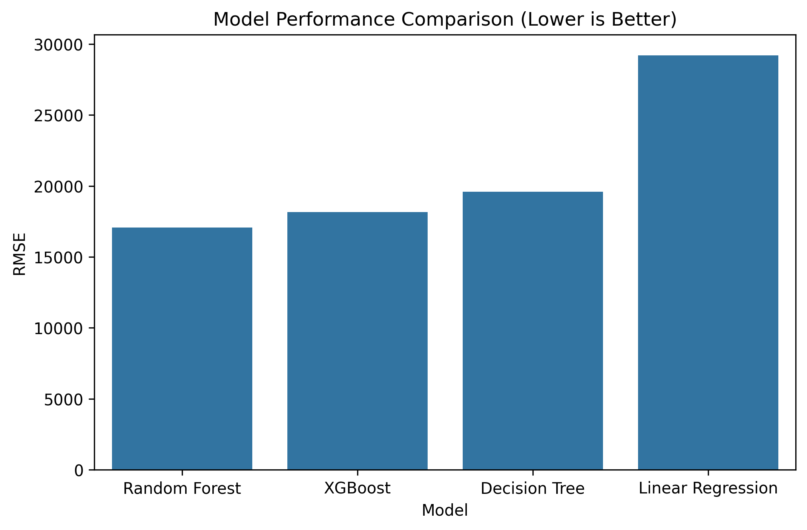
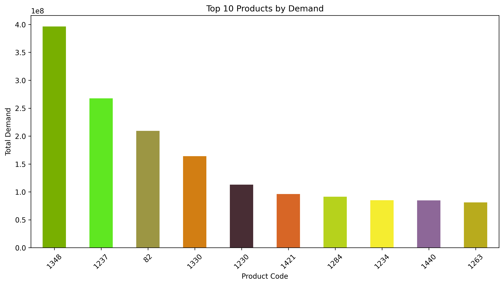
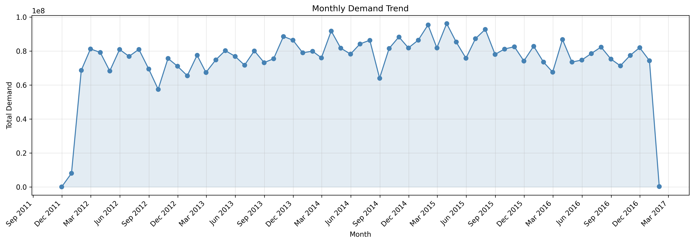
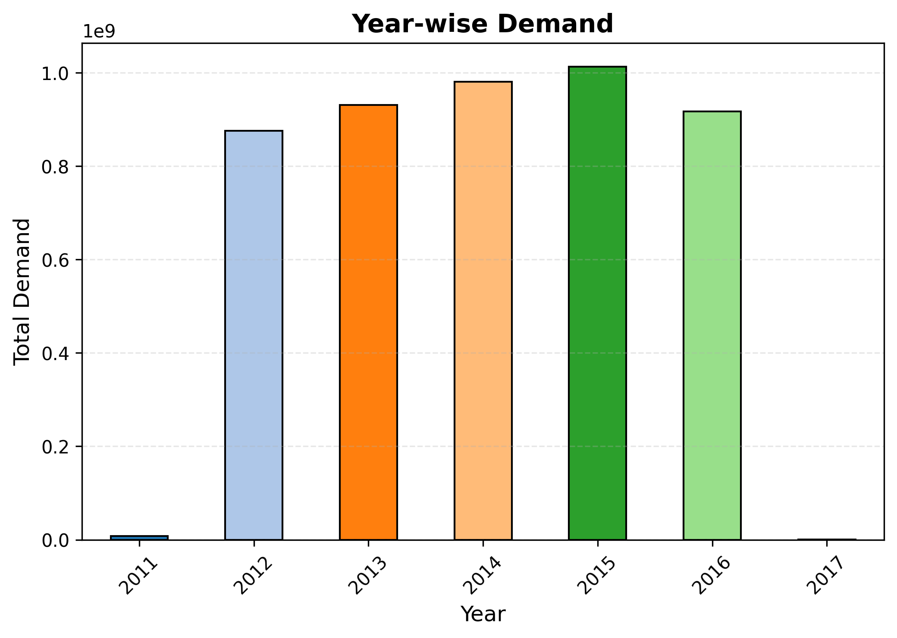

# Demand Forecasting using Machine Learning

A machine learning project that forecasts product demand from historical sales data. Four regression models are compared on a held-out test set, and the best performer (Random Forest) is saved for reuse.


---

## Problem Statement

Businesses lose money when they stock too much (storage costs, waste) or too little (lost sales, unhappy customers). Accurate demand forecasts help with inventory planning, purchasing, and staffing.

This project builds and compares ML models that predict demand, and identifies which one performs best.

## Dataset

- **Source:** https://www.kaggle.com/code/flavioakplaka/product-demand-forecast/input
- **Size:** 1048575 rows, 5 columns
-  **Target variable:** `Order_Demand`
- **Date column:** `Date`

## Approach

1. **Data preparation:** sorted records chronologically, converted dates, and removed rows with missing values created by lagging.
2. **Feature engineering:**
   - **Calendar features:** year, month, day, weekday, quarter
   - **Cyclical encoding:** sine/cosine transforms of month and weekday, so the model knows December is next to January and Sunday is next to Monday
   - **Lag features:** demand 1, 7, and 30 days earlier
   - **Rolling statistics:** 7-day rolling mean and standard deviation of past demand
3. **Train/test split:** chronological split, with the earliest 80% of the data for training and the latest 20% for testing, so the model never sees future data.
4. **Modeling:** trained Linear Regression, Decision Tree, Random Forest, and XGBoost.
5. **Model saving:** exported the best model with joblib.


## Models Compared

| Model | Key Settings |
|---|---|
| Linear Regression | Default |
| Decision Tree | `max_depth=12`, `min_samples_split=10` |
| Random Forest | `n_estimators=200`, `max_depth=12`, `min_samples_split=10` |
| XGBoost | `n_estimators=300`, `learning_rate=0.05`, `max_depth=6`, `subsample=0.8`, `colsample_bytree=0.8` |

## Results

| Model | MAE | RMSE | R² |
|---|---|---|---|
| **Random Forest** | **3,947.98** | **17,067.65** | **0.717** |
| XGBoost | 4,497.84 | 18,174.47 | 0.679 |
| Decision Tree | 3,995.96 | 19,600.55 | 0.626 |
| Linear Regression | 7,565.84 | 29,203.00 | 0.171 |

**Best model: Random Forest.**

- It reduced RMSE by about 42% and MAE by about 48% compared with Linear Regression.
- It explains roughly 72% of the variance in demand.
- Tree-based models clearly outperformed the linear model, which suggests the relationship between features and demand is non-linear.

### Visualizations














## How to Run

```bash
# 1. Clone the repository
git clone https://github.com/<your-username>/demand-forecasting-ml.git
cd demand-forecasting-ml

# 2. Install dependencies
pip install -r requirements.txt

# 3. Open the notebook
jupyter notebook notebooks/demand_forecasting.ipynb
```

## Tech Stack

- Python
- pandas, NumPy
- scikit-learn
- XGBoost
- Matplotlib, Seaborn
- joblib

## Future Improvements

- Add a naive baseline (previous week's demand) to benchmark all models
- Hyperparameter tuning for XGBoost and Random Forest
- Time-series cross-validation with `TimeSeriesSplit`
- Try LightGBM, Prophet, or LSTM models
- Deploy as a Streamlit web app for interactive forecasts

## Author

**[RENU MAHATo]**

[LinkedIn](www.linkedin.com/in/renu-kumari-84414a387) · [GitHub](https://github.com/RenuMahato)

---
